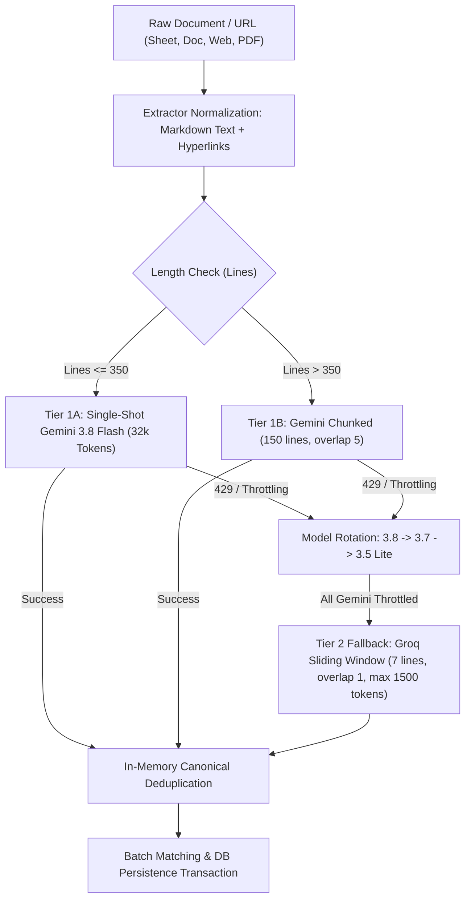
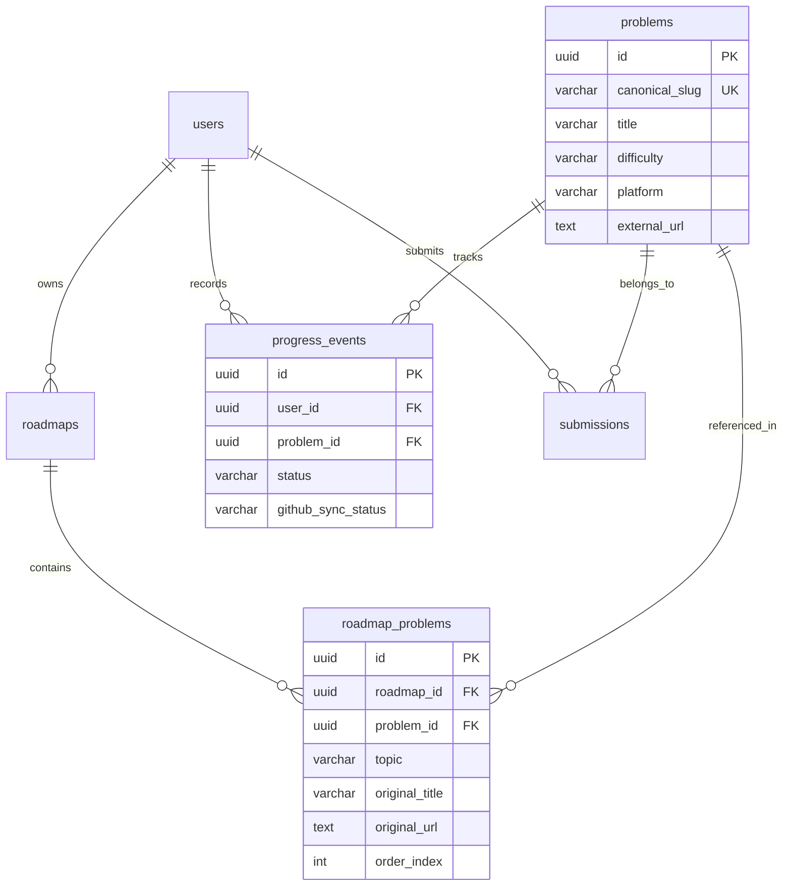
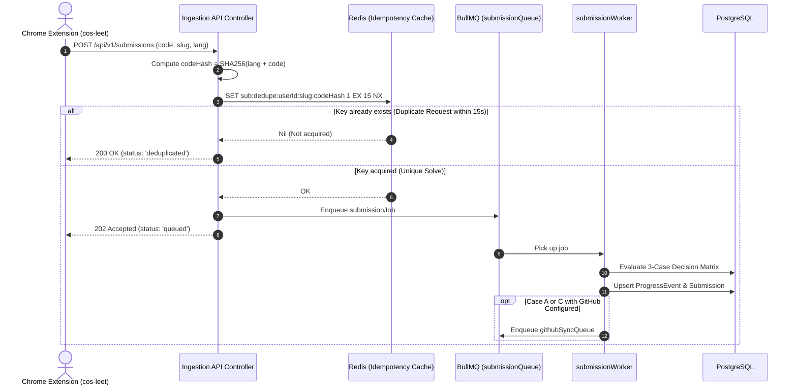

# Career OS — Technical Interview Preparation & Architecture Deep Dive Guide

> **Target Audience:** Engineering Leads, Senior System Design Interviewers, Technical Hiring Managers, and Technical Recruiters.  
> **Core Themes:** Ingestion Pipelines, Chunking Strategies, LLM vs. Deterministic Parsing, Canonical Problem Modeling, Idempotent Event Workers, Edge Proxy Authentication, and High-Throughput System Design.

---

## Table of Contents

1. [Executive Summary & 60-Second Pitch](#1-executive-summary--60-second-pitch)
2. [Section 1: Ingestion Engine, Chunking & LLM vs. Concrete Parsing](#2-section-1-ingestion-engine-chunking--llm-vs-concrete-parsing)
   - [Q1: Why an LLM instead of a concrete regex/DOM parser?](#q1-why-did-you-use-an-llm-for-roadmap-ingestion-instead-of-a-concrete-parser)
   - [Q2: Document chunking strategy & provider token constraints](#q2-how-did-you-design-your-document-chunking-strategy)
   - [Q3: Multi-tier LLM cascade, model rotation & rate limit handling](#q3-how-does-your-ingestion-pipeline-handle-llm-rate-limits-and-outages)
   - [Q4: Preserving embedded hyperlinks during sheet extraction](#q4-how-did-you-preserve-embedded-hyperlinks-from-google-sheets)
3. [Section 2: Canonical Problem Bank & Cross-Platform Identity Resolution](#3-section-2-canonical-problem-bank--cross-platform-identity-resolution)
   - [Q5: The Cross-Roadmap Silo problem & relational decoupling](#q5-what-was-the-cross-roadmap-silo-problem-and-why-decouple-problems)
   - [Q6: Algorithmic identity resolution across LeetCode, GFG, and CodeStudio](#q6-how-do-you-resolve-problem-identity-across-different-platforms)
   - [Q7: 3-Query batch persistence & avoiding PostgreSQL 21000 errors](#q7-how-do-you-batch-persist-problems-without-n1-queries-or-deadlocks)
4. [Section 3: Submission Pipeline, Deduplication & Event-Driven Workers](#4-section-3-submission-pipeline-deduplication--event-driven-workers)
   - [Q8: Multi-layer idempotency (SHA-256 hash & 15s Redis lock)](#q8-how-does-the-submission-pipeline-handle-rapid-fire-requests)
   - [Q9: The 3-Case Decision Matrix in the submission worker](#q9-explain-the-3-case-decision-matrix-in-your-submission-worker)
   - [Q10: Asynchronous worker pools vs. synchronous API processing](#q10-why-use-bullmq-and-redis-workers-instead-of-synchronous-apis)
5. [Section 4: Performance Optimization, Caching & Data Isolation](#5-section-4-performance-optimization-caching--data-isolation)
   - [Q11: The "Clone-on-Ingest" pattern for token & cost savings](#q11-explain-the-clone-on-ingest-optimization)
   - [Q12: Smart polling with lightweight status endpoints vs. WebSockets](#q12-why-choose-smart-polling-over-websockets-or-sse-for-ingestion)
6. [Section 5: Authentication, Security & Production War Stories](#6-section-5-authentication-security--production-war-stories)
   - [Q13: The RFC 6265 Cookie Scoping bug & Next.js Edge Proxy deadlock](#q13-tell-me-about-a-difficult-production-bug-you-diagnosed-and-fixed)
   - [Q14: Fail-open rate limiting & security hardening](#q14-how-does-rate-limiting-behave-if-redis-fails-fail-open-vs-fail-closed)
7. [Section 6: Behavioral, Leadership & System Scalability Questions](#7-section-6-behavioral-leadership--system-scalability-questions)
   - [Q15: The hardest architectural dilemma and future v2 improvements](#q15-what-was-the-most-difficult-architectural-decision-you-made)
   - [Q16: System bottlenecks and scaling to 100x user volume](#q16-if-traffic-grows-100x-overnight-what-fails-first-and-how-do-you-scale)
8. [Quick Reference Cheat Sheet](#8-quick-reference-cheat-sheet)

---

## 1. Executive Summary & 60-Second Pitch

> **Interviewer:** *"Can you give me a high-level elevator pitch of Career OS?"*

**Your Answer Blueprint:**
"Software engineers preparing for technical interviews often maintain fragmented systems: curated spreadsheets (like Striver's SDE Sheet or NeetCode 150), multiple practice platforms (LeetCode, GeeksforGeeks, CodeStudio), personal GitHub repos, and Notion notes. Tracking unified progress across all of them is manual and tedious.

**Career OS** is an intelligent developer workspace designed as a personal Career Operating System. It solves two fundamental architectural problems:
1. **Unstructured Roadmap Ingestion:** Using a multi-tier LLM extraction cascade with sliding-window chunking, it converts messy, arbitrary Google Sheets, Docs, and PDFs into structured curricula in seconds.
2. **The Canonical Problem Bank:** Instead of siloing questions per roadmap, we decoupled problems into a universal canonical bank with many-to-many junction mapping. When an engineer solves a problem on LeetCode using our Chrome extension, it normalizes the code, checks distributed Redis idempotency locks, and automatically synchronizes the solved status across every roadmap containing that problem, while backing up the solution to GitHub."

---

## 2. Section 1: Ingestion Engine, Chunking & LLM vs. Concrete Parsing



### Q1: Why did you use an LLM for roadmap ingestion instead of a concrete parser?

* **Interviewer Intent:** Evaluates your ability to weigh developer velocity, maintenance overhead, input variability, and cost.
* **Curated Follow-ups:**
  * *"Deterministic parsers cost $0 and execute in 2ms. How do you justify LLM costs and latency?"*
  * *"How do you guarantee output validity without hallucinations?"*
* **Detailed Answer & Code Evidence:**
  1. **Extreme Input Heterogeneity:** Community study sheets lack standardization. One author uses 4 columns (`[Day, Topic, Problem, Link]`), another uses nested bullet points, while others embed links inside cell anchor tags without separate URL columns. A deterministic parser (AST, Regex, Cheerio) breaks every time an author alters their format.
  2. **Semantic Knowledge & Missing Metadata:** Real sheets frequently omit critical fields:
     * A row might only state `"Serialize and Deserialize Binary Tree"`. A concrete parser stores `null` for difficulty and category.
     * An LLM uses its parametric knowledge base to infer: `Category: Binary Trees`, `Difficulty: Hard`, and `Platform: LeetCode`.
  3. **Strict Schema Adherence via Vercel AI SDK:** We eliminated hallucinated freeform text by enforcing type-safe JSON schema output (`Output.object` with `zod` schema `ChunkResultSchema` in [`backend/src/services/ingestion/llmParser.service.ts`](file:///e:/DevProjects/COS/backend/src/services/ingestion/llmParser.service.ts)).
  4. **Cost Mitigation via 'Clone-on-Ingest':** The LLM is only called **once** per unique sheet URL across the entire platform. Subsequent users importing that same URL execute a $0-token database clone taking ~5ms.
* **Red Flags to Avoid:** Don't say *"I used an LLM because AI is powerful."* Ground your reasoning in input variability, maintenance cost of scrapers, and schema enforcement.

---

### Q2: How did you design your document chunking strategy?

* **Interviewer Intent:** Tests understanding of context windows, token limits, sliding windows, and JSON truncation bugs.
* **Curated Follow-ups:**
  * *"Why did you use 7 lines with 1 overlap for Groq, but 150–350 lines for Gemini?"*
  * *"How did you prevent cutting problems in half across chunk boundaries?"*
* **Detailed Answer & Code Evidence:**
  1. **Asymmetric Provider Quotas & Truncation Risks:**
     * **Groq Free Tier:** 8,000 TPM rate limit and small output generation limits (~1,500 max output tokens). If Groq receives 30 lines, its generated JSON array exceeds 1,500 tokens, truncating mid-JSON and triggering fatal syntax errors. Hence, Groq uses conservative chunking: **7 lines with 1 line overlap** ([`chunker.service.ts`](file:///e:/DevProjects/COS/backend/src/services/ingestion/chunker.service.ts)).
     * **Gemini 3.8 Flash:** Features a 1M token context window and 32,000 output token buffer. It can easily extract 300+ problems in a single shot. Documents with $\le 350$ lines are processed in one pass; documents $> 350$ lines are chunked into 150-line blocks.
  2. **Sliding Window Overlap:** Setting `overlap = 1` guarantees that if a problem title and its practice link sit on adjacent lines or headers, they are never separated across chunks. Downstream deduplication maps collapse duplicates seamlessly.

---

### Q3: How does your ingestion pipeline handle LLM rate limits and outages?

* **Interviewer Intent:** Assesses fault-tolerant design and third-party API resilience.
* **Curated Follow-ups:**
  * *"How do you differentiate between transient rate limits and hard API failures?"*
  * *"What happens if all AI providers are down simultaneously?"*
* **Detailed Answer & Code Evidence:**
  1. **Tiered Fallback Cascade ([`ADR-002`](file:///e:/DevProjects/COS/docs/decisions/ADR-002-llm-cascade-and-caching.md) & [`pipeline.service.ts`](file:///e:/DevProjects/COS/backend/src/services/ingestion/pipeline.service.ts)):**
     * **Tier 1:** Gemini 3.8 Flash $\rightarrow$ Gemini 3.7 Flash $\rightarrow$ Gemini 3.5 Flash Lite.
     * **Tier 2:** Groq (`openai/gpt-oss-20b`).
  2. **Error Classification:** Using `APICallError.isInstance(err)`, status codes `429`, `503`, and `504` trigger automatic rotation to the next model. High-demand strings (`"high demand"`, `"temporary"`) are also caught via regex guards.
  3. **Pacing & Backoff:** Groq chunking batches requests with concurrency limits and applies an 8-second backoff pause when a 429 TPM limit is detected.
  4. **Quality Gate Failure Path:** If extraction yields 0 problems, the ingestion worker transitions the database record to `FAILED` with an informative user message, terminating background processing safely.

---

### Q4: How did you preserve embedded hyperlinks from Google Sheets?

* **Interviewer Intent:** Evaluates attention to raw data ingestion and Google Sheets API v4 mechanics.
* **Detailed Answer & Code Evidence:**
  * In [`googleSheet.extractor.ts`](file:///e:/DevProjects/COS/backend/src/services/extractors/googleSheet.extractor.ts), fetching only `formattedValue` strips all underlying URL links.
  * We requested `fields: 'sheets(properties(title),data(rowData(values(formattedValue,hyperlink))))'`.
  * During cell mapping, if a cell possesses an underlying hyperlink, we serialize it as Markdown: `[${cell.formattedValue}](${cell.hyperlink})`.
  * This preserves the ground-truth URL for the LLM while retaining tabular text context (`cell1 | cell2 | cell3`).

---

## 3. Section 2: Canonical Problem Bank & Cross-Platform Identity Resolution



### Q5: What was the 'Cross-Roadmap Silo' problem, and why decouple problems?

* **Interviewer Intent:** Tests database normalization, relational modeling, and user journey optimization.
* **Curated Follow-ups:**
  * *"Why not simply keep `roadmap_id` as a foreign key on the `problems` table?"*
  * *"If two roadmaps share a problem, how does marking it solved in Roadmap A update Roadmap B?"*
* **Detailed Answer & Code Evidence:**
  1. **The Silo Defect:** In early versions, `Problem` had a strict `roadmap_id FK`. If a user imported *Striver SDE Sheet* and *NeetCode 150*, common questions like "Two Sum" existed in duplicate rows. Solving it in Roadmap A left Roadmap B marked as unsolved.
  2. **The Decoupled Schema ([`ADR-003`](file:///e:/DevProjects/COS/docs/decisions/ADR-003-canonical-problems-and-identity-resolution.md)):**
     * `problems`: Global canonical repository keyed by unique `canonical_slug`.
     * `roadmap_problems`: Junction table preserving the sheet author’s specific metadata (`original_title`, `original_url`, `topic`, `order_index`).
     * `progress_events`: Scoped strictly to `(user_id, problem_id)`.
  3. **Automatic Synchronization:** When User A solves "Two Sum", their single `progress_event` row flips to `SOLVED`. Because all user roadmaps join onto the same canonical `problem_id`, all roadmaps instantly reflect the solved state.

---

### Q6: How do you resolve problem identity across different platforms?

* **Interviewer Intent:** Evaluates string manipulation, URL parsing, regex mastery, and edge-case handling.
* **Curated Follow-ups:**
  * *"How do you handle platform-specific hash suffixes (like GFG's `key-pair5556/1`)?"*
  * *"What happens if a user inputs a problem title with only symbols or emojis?"*
* **Detailed Answer & Code Evidence:**
  * Reference [`resolveCanonicalSlug`](file:///e:/DevProjects/COS/backend/src/utils/canonicalSlug.ts#L90-L100):
  1. **URL-First Resolution:** Practice platforms follow structured URI paths:
     * **LeetCode:** `/problems/two-sum` or `/problems/two-sum/description` $\rightarrow$ `two-sum`.
     * **GeeksforGeeks:** `/problems/key-pair5556/1` $\rightarrow$ strips trailing numeric hashes $\rightarrow$ `key-pair`.
     * **CodeStudio / Naukri Code360:** `/problems/two-sum_839653` $\rightarrow$ splits by underscore $\rightarrow$ `two-sum`.
     * **HackerRank:** `/challenges/simple-array-sum` $\rightarrow$ `simple-array-sum`.
  2. **Title Normalization Fallback:** If no URL is provided, strip prefixes (`"1. "`, `"Problem 4: "`, `"[Easy]"`), lowercase, and convert non-alphanumerics to hyphens.
  3. **Defensive Hash Fallback:** If regex sanitization reduces a title to an empty string `""` (e.g. title is `"!@#$"`), standard slugifiers cause PostgreSQL unique constraint crashes. We generate a deterministic SHA-256 fallback: `problem-${sha256(raw).slice(0, 8)}`.

---

### Q7: How do you batch-persist problems without $N+1$ queries or deadlocks?

* **Interviewer Intent:** Tests high-performance database writes, transaction isolation, and PostgreSQL conflict mechanics.
* **Curated Follow-ups:**
  * *"Why did PostgreSQL throw `ERROR: 21000: ON CONFLICT DO NOTHING cannot affect row a second time`?"*
* **Detailed Answer & Code Evidence:**
  * In [`problems.service.ts`](file:///e:/DevProjects/COS/backend/src/services/problems.service.ts#L65-L120), we execute a **3-Query Batch Transaction**:
    1. **Query 1:** `SELECT id, canonical_slug FROM problems WHERE canonical_slug IN (:slugs)`.
    2. **In-Memory Partition:** Compare incoming items against existing records in an $O(1)$ lookup `Map<canonicalSlug, problemId>`.
    3. **Query 2:** Bulk insert only the *unmatched* problems via Prisma's `createManyAndReturn`, merging newly minted IDs into the map.
    4. **Query 3:** Bulk insert junction records into `roadmap_problems` linking `roadmapId` with `problemId`.
  * **The Postgres `21000` Fix:** If an imported sheet lists the same problem twice in different sections, a bulk insert attempts to insert identical `(roadmap_id, problem_id)` pairs in a single statement. Postgres rejects this with `ERROR: 21000`. We eliminated this by deduplicating incoming items by `canonicalSlug` in memory before firing SQL queries.

---

## 4. Section 3: Submission Pipeline, Deduplication & Event-Driven Workers



### Q8: How does the submission pipeline handle rapid-fire requests?

* **Interviewer Intent:** Evaluates idempotency at the network and database layers.
* **Curated Follow-ups:**
  * *"Why use a 15-second Redis key instead of solely relying on database constraints?"*
* **Detailed Answer & Code Evidence:**
  1. **Layer 1: Deterministic Hashing:** Compute a SHA-256 hash of `language + ":" + code.trim()`.
  2. **Layer 2: Redis Distributed Mutex:** Prior to touching the database or queue, the controller executes:
     ```typescript
     const dedupeKey = `sub:dedupe:${userId}:${slug}:${codeHash}`;
     const acquired = await redisClient.set(dedupeKey, '1', 'EX', 15, 'NX');
     ```
  3. **Why Redis First:** Rapid double-clicks from the browser or network retries can send multiple HTTP requests within milliseconds. Hitting PostgreSQL directly causes transaction deadlocks and connection pool exhaustion. Redis `SET ... NX` absorbs bursts in $<1\text{ms}$ with zero DB footprint.

---

### Q9: Explain the '3-Case Decision Matrix' in your submission worker.

* **Interviewer Intent:** Assesses business logic modeling, side-effect prevention, and asynchronous resource stewardship.
* **Detailed Answer & Code Evidence:**
  * Reference [`SubmissionService.processSubmissionJob`](file:///e:/DevProjects/COS/backend/src/services/submission.service.ts#L174-L200):
    * **Case A: First-Time Solve:** No existing `progress_events` record exists. Create `progress_events` with `status: SOLVED`, insert `submissions` record, and trigger downstream GitHub sync and AI revision workers.
    * **Case B: Identical Code Hash:** User re-submitted the same code. Touch `updatedAt` on existing records and **halt**. Do not trigger GitHub sync or AI review (preserves GitHub API quotas and token budgets).
    * **Case C: Updated Code / Optimization:** User altered or optimized their solution (different `codeHash`). Update `submissions` in-place, refresh `progress_events`, and enqueue `githubSyncQueue` with a deterministic job ID (`gh-sync-${submission.id}-${codeHash12}`) to overwrite the solution file cleanly.

---

### Q10: Why use BullMQ and Redis workers instead of synchronous APIs?

* **Interviewer Intent:** Tests understanding of HTTP lifecycle constraints, backpressure, and worker pools.
* **Detailed Answer & Code Evidence:**
  * **Timeout Isolation:** Extracting roadmaps via LLMs takes 15–45 seconds. Synchronous HTTP execution risks client/proxy timeouts (Vercel 15s, Nginx 30s) and blocks server worker threads.
  * **Controlled Concurrency:** BullMQ worker instances enforce strict concurrency:
    * `ingestionWorker`: `concurrency = 2` (prevents scraping rate limits and downstream LLM quota saturation).
    * `submissionWorker`: `concurrency = 5` (provides rapid ingestion of code solves).
  * **Crash Recovery:** BullMQ tracks locks. If a worker process abruptly dies mid-extraction, `maxStalledCount: 3` ensures another worker reclaims and finishes the job.

---

## 5. Section 4: Performance Optimization, Caching & Data Isolation

### Q11: Explain the "Clone-on-Ingest" optimization.

* **Interviewer Intent:** Evaluates caching strategies that balance data deduplication with multi-tenant data ownership.
* **Curated Follow-ups:**
  * *"Why not use a many-to-many subscription table where all users point to one shared Roadmap record?"*
* **Detailed Answer & Code Evidence:**
  1. **The Shared Roadmap Pitfall:** If 500 users share one `Roadmap` entity, personal user modifications (renaming modules, tracking custom roadmap notes, reordering problems) require complex per-user override tables.
  2. **The Clone-on-Ingest Solution ([`ADR-002`](file:///e:/DevProjects/COS/docs/decisions/ADR-002-llm-cascade-and-caching.md)):** When User B imports a URL already ingested by User A:
     * Check `roadmaps` for `source_url` with `status = 'COMPLETED'`.
     * Completely bypass scrapers and LLMs ($0 tokens, ~5ms response).
     * Create a new `roadmaps` record owned by User B.
     * Batch copy rows from `roadmap_problems`, linking to the **identical canonical `problem_id`s**.
  3. **Consequences:** 100% individual user data isolation with zero duplicated canonical problems and zero redundant LLM token costs.

---

### Q12: Why choose Smart Polling over WebSockets or SSE for ingestion?

* **Interviewer Intent:** Demonstrates pragmatic architecture selection and avoiding unnecessary operational complexity.
* **Detailed Answer & Code Evidence:**
  * **Protocol Evaluation ([`problem-summary.md`](file:///e:/DevProjects/COS/docs/problem-summary.md) Entry 02):**
    * *WebSockets:* Overkill. Ingestion status is strictly unidirectional (server $\rightarrow$ client) and short-lived. Stateful socket connections add unnecessary operational overhead across auto-scaling instances.
    * *SSE:* Requires server instances to subscribe to Redis Pub/Sub channels to bridge background workers to HTTP clients.
    * *Smart Polling:* Stateless, works seamlessly across load balancers, tab suspensions, and client refreshes.
  * **Avoiding Database Load via Dedicated Status Endpoint:** Polling `GET /roadmaps/:id` triggers heavy joins across 4 tables. Instead, we built `GET /api/v1/ingest/status/:roadmapId`, executing a primary-key index lookup that selects only `{ id, status, errorMessage, _count }`.
  * **Frontend Lifecycle Protections ([`use-ingest-polling.ts`](file:///e:/DevProjects/COS/frontend/src/features/ingest/hooks/use-ingest-polling.ts)):**
    * **Tab Visibility Guard:** Pauses polling when `document.visibilityState === 'hidden'`.
    * **Timeout Cap:** Automatically terminates polling after 70 attempts (~3 minutes) to prevent zombie network loops.

---

## 6. Section 5: Authentication, Security & Production War Stories

### Q13: Tell me about a difficult production bug you diagnosed and fixed.

* **Interviewer Intent:** Verifies hands-on debugging depth across frontend runtimes, edge proxies, and backend cookie specifications.
* **The Story (Next.js Edge Proxy Cookie Path Scoping Deadlock):**
  * **The Symptom:** After 15 minutes of user inactivity (access token expiration), clicking any dashboard link redirected to `/login`, where the UI permanently froze on an infinite loading spinner.
  * **Layer 1: RFC 6265 Cookie Scoping Flaw:** In `backend/src/utils/tokens.ts`, the refresh token cookie was scoped to `path: '/api/v1/auth'`. Per RFC 6265, when the Next.js Edge Proxy (`localhost:3000/dashboard/*`) forwarded the request, the browser omitted the refresh cookie. The backend returned 401 and wiped the session.
  * **Layer 2: Next.js App Router In-Memory Persistence:** In Next.js App Router, client-side redirects do not unmount `RootLayout`. The `AuthProvider` maintained module-scoped variables (`cachedUser != null`), keeping React state `isAuthenticated: true`.
  * **Layer 3: The Redirect Deadlock:** `LoginForm` observed `isAuthenticated: true` and pushed to `/dashboard`. Edge proxy caught the expired token and redirected back to `/login`. This created an infinite client-server redirect bounce.
  * **The Fix:**
    1. Scoped the refresh token cookie to `path: '/'` so the Next.js Edge Proxy receives it for silent rotation.
    2. Added route observation in `auth-context.tsx` to explicitly invalidate stale module caches upon landing on `/login`.

---

### Q14: How does rate limiting behave if Redis fails (Fail-Open vs. Fail-Closed)?

* **Interviewer Intent:** Evaluates high availability, reliability trade-offs, and fault tolerance.
* **Detailed Answer & Code Evidence:**
  * In [`rateLimit.middleware.ts`](file:///e:/DevProjects/COS/backend/src/middleware/rateLimit.middleware.ts), we configured `passOnStoreError: true`.
  * **Fail-Open Strategy:** If Redis suffers temporary network partitioning, standard API requests proceed without interruption. In a developer workspace SaaS, **availability takes precedence over strict rate limiting**.
  * **Exceptions:** High-risk endpoints (such as OTP generation or password reset verification) can be set to fail-closed to protect against brute-force attacks during outages.

---

## 7. Section 6: Behavioral, Leadership & System Scalability Questions

### Q15: What was the most difficult architectural decision you made?

* **Interviewer Intent:** Assesses technical maturity, retrospective self-awareness, and architectural vision.
* **Detailed Answer (The "Default Roadmap" vs. "Global Activity Feed" Dilemma):**
  * **The Dilemma ([`problem-summary.md`](file:///e:/DevProjects/COS/docs/problem-summary.md) Entry 01):** When users solved LeetCode POTD or contest problems not in any imported roadmap, we initially considered routing them into an auto-provisioned "Default Roadmap".
  * **Why We Rejected It:** A **Roadmap** is a structured curriculum with a finite milestone ($45 / 75 = 60\%$). Activity stream solves continuously increment the denominator, corrupting progress metrics. Moreover, forcing submission workers to find-or-create default roadmaps introduced severe database locking.
  * **What We Did Instead:** Treated Roadmap as *curriculum metadata*, elevating Solved Problems into a first-class Global Solved Problem feed.
  * **V2 Roadmap (pgvector Embeddings):** For problems with differing names across platforms (e.g. "Key Pair" vs. "Two Sum"), we plan to introduce vector embeddings (`pgvector`) on problem statements for true semantic deduplication.

---

### Q16: If traffic grows 100x overnight, what fails first, and how do you scale?

* **Interviewer Intent:** Tests systems thinking, horizontal scalability, and bottleneck identification.
* **Detailed Bottleneck Breakdown:**
  1. **LLM Quota Saturation:**
     * *Bottleneck:* Upstream providers throttle requests.
     * *Mitigation:* The BullMQ queue with concurrency limits (`concurrency = 2`) acts as a shock absorber. Users poll status asynchronously while Clone-on-Ingest skips redundant sheets entirely.
  2. **Database Connection Pool Exhaustion:**
     * *Bottleneck:* Express servers and BullMQ workers exhaust PostgreSQL connection limits under load.
     * *Mitigation:* Place **PgBouncer** in transaction pooling mode between Prisma clients and PostgreSQL.
  3. **Redis Memory Bloat:**
     * *Bottleneck:* Retaining thousands of completed BullMQ job payloads fills Redis RAM.
     * *Mitigation:* Configure `removeOnComplete: { count: 100 }` and `removeOnFail: { count: 500 }`.

---

## 8. Quick Reference Cheat Sheet

| Domain | Core Architectural Concept | Key Code / Artifact Reference |
| :--- | :--- | :--- |
| **Ingestion Engine** | Sliding window chunking (7 lines Groq vs. 150/350 lines Gemini) | [`chunker.service.ts`](file:///e:/DevProjects/COS/backend/src/services/ingestion/chunker.service.ts), [`pipeline.service.ts`](file:///e:/DevProjects/COS/backend/src/services/ingestion/pipeline.service.ts) |
| **LLM Schema Extraction** | Vercel AI SDK `Output.object` with strict Zod validation | [`llmParser.service.ts`](file:///e:/DevProjects/COS/backend/src/services/ingestion/llmParser.service.ts), [`problem.schema.ts`](file:///e:/DevProjects/COS/backend/src/schemas/problem.schema.ts) |
| **Model Cascade** | Gemini 3.8 $\rightarrow$ 3.7 $\rightarrow$ 3.5 Lite $\rightarrow$ Groq fallback | [`ADR-002`](file:///e:/DevProjects/COS/docs/decisions/ADR-002-llm-cascade-and-caching.md) |
| **Data Deduplication** | "Clone-on-Ingest" SQL cloning ($\sim 5\text{ms}$, \$0 token cost) | [`ADR-002`](file:///e:/DevProjects/COS/docs/decisions/ADR-002-llm-cascade-and-caching.md), [`roadmap.service.ts`](file:///e:/DevProjects/COS/backend/src/services/roadmap.service.ts) |
| **Canonical Problem Bank** | Decoupled `roadmaps`, `problems`, and `roadmap_problems` | [`ADR-003`](file:///e:/DevProjects/COS/docs/decisions/ADR-003-canonical-problems-and-identity-resolution.md), `schema.dbml` |
| **Identity Resolution** | URL slug parsing (LeetCode/GFG/CodeStudio) + SHA-256 fallback | [`canonicalSlug.ts`](file:///e:/DevProjects/COS/backend/src/utils/canonicalSlug.ts) |
| **Batch DB Transactions** | 3-query transaction with in-memory partitioning | [`problems.service.ts`](file:///e:/DevProjects/COS/backend/src/services/problems.service.ts) |
| **Submission Idempotency** | SHA-256 code hash + 15s Redis `SET ... NX` mutex | [`submission.service.ts`](file:///e:/DevProjects/COS/backend/src/services/submission.service.ts), [`codeHash.ts`](file:///e:/DevProjects/COS/backend/src/utils/codeHash.ts) |
| **Decision Matrix** | 3-Case Matrix: First-time solve vs. Identical code vs. Optimization | [`submission.service.ts`](file:///e:/DevProjects/COS/backend/src/services/submission.service.ts) |
| **Ingestion Streaming** | Smart polling with dedicated lightweight status endpoint | [`problem-summary.md`](file:///e:/DevProjects/COS/docs/problem-summary.md) Entry 02, [`use-ingest-polling.ts`](file:///e:/DevProjects/COS/frontend/src/features/ingest/hooks/use-ingest-polling.ts) |
| **Production War Story** | RFC 6265 cookie scoping (`path: '/'`) & Next.js Edge deadlock | [`problem-summary.md`](file:///e:/DevProjects/COS/docs/problem-summary.md) Entry 04 |
| **Security & Resilience** | Fail-open Redis rate limiting (`passOnStoreError: true`) | [`rateLimit.middleware.ts`](file:///e:/DevProjects/COS/backend/src/middleware/rateLimit.middleware.ts) |
